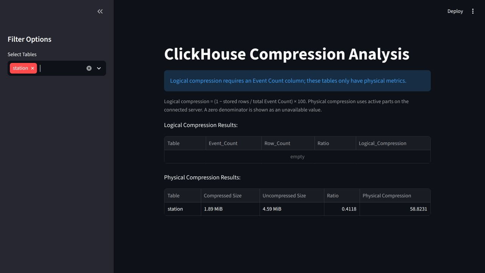
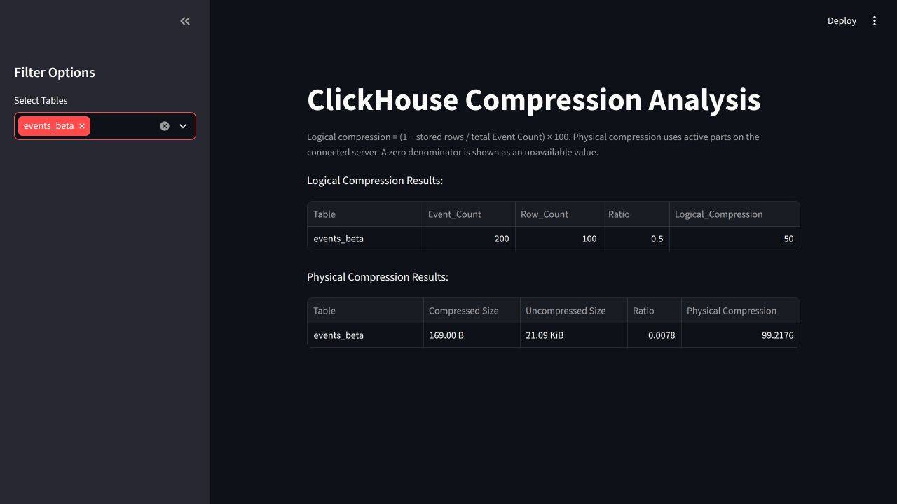

# ClickHouse compression dashboard

A Streamlit dashboard that discovers ClickHouse tables, extracts logical and physical compression metrics, and displays filterable Polars dataframes. All runtime SQL lives in [`sql/`](sql/).

## Run locally

Verified with Python 3.12, Streamlit 1.66.1, Polars 2.0.0, ClickHouse Connect 1.11.0, and a Docker-hosted ClickHouse 26.9.25.15 server.

```sh
uv venv --python 3.12
uv pip install -r requirements-dev.txt
cp .env.example .env
```

Edit `.env` with your server's credentials. For the local Docker HTTP endpoint, use:

```dotenv
CLICKHOUSE_BASE_URL=127.0.0.1
CLICKHOUSE_PORT=8123
CLICKHOUSE_SECURE=false
CLICKHOUSE_DATABASE=default
CLICKHOUSE_USER=your_existing_user
CLICKHOUSE_PASSWORD=your_existing_password
CLICKHOUSE_COMPRESSION_PROTOCOL=lz4
CLICKHOUSE_BATCH_SIZE=10000
```

`CLICKHOUSE_BASE_URL` is a hostname or IP address, without a URL scheme. Use HTTP port `8123`, or your HTTPS port with `CLICKHOUSE_SECURE=true`; native TCP port `9000` is incompatible with this driver. The default HTTPS settings in `.env.example` use port `8443`.

`CLICKHOUSE_BATCH_SIZE` is retained from the original settings contract; this dashboard performs no inserts. `CLICKHOUSE_DATABASE` defaults to `default` and `CLICKHOUSE_SECURE` defaults to `true`. The other settings are required. Environment variables take precedence over `.env`.

Run commands from the repository root:

```sh
.venv/bin/python -m streamlit run clickhouse_admin_panel.py --server.address 127.0.0.1
```

Open [the dashboard](http://127.0.0.1:8501). The dashboard needs SELECT access to the selected tables and the corresponding `system.tables`, `system.columns`, and `system.parts` metadata. It closes its client after each extraction and does not set insert options. Connection, query, and schema failures propagate to Streamlit rather than being converted into empty or successful results.

## Metric contracts

Discovery includes stored tables whose engines end in `MergeTree` in the configured database. It excludes views, non-MergeTree engines, internal `.inner*` tables, and names ending in `MV` (case insensitive, preserving the original suffix convention).

| Metric | Calculation | Required data |
| --- | --- | --- |
| Logical ratio | Stored row count / sum of `Event Count` | An `Event Count` column containing nonnegative integer counts whose total fits UInt64 |
| Logical compression (%) | `(1 - logical ratio) * 100` | Same as logical ratio |
| Physical ratio | Compressed data bytes / uncompressed data bytes | Active parts for that database and table |
| Physical compression (%) | `(1 - physical ratio) * 100` | Same as physical ratio |

Logical metrics only apply to tables with the exact `Event Count` column name. Tables without it still have physical metrics and remain selectable. The app explicitly explains when none of the discovered tables supports logical metrics. It does not infer event counts from unrelated columns.

Logical aggregation scans the selected source tables in full. The ClickHouse review checked `schema-pk-filter-on-orderby` and `query-index-skipping-indices`; these whole-table totals have no selective source predicate to optimize. The queries contain no JOINs, so the JOIN algorithm, pre-filtering, and ANY JOIN rules do not apply.

Physical metrics exclude inactive parts and auxiliary files such as indexes. They describe the connected server, not a cluster-wide or replicated total. Small tables can have negative physical compression when storage encoding is larger than the uncompressed data. A zero denominator produces SQL NULL, displayed as unavailable, rather than NaN or infinity. Percentages remain numeric in both dataframes.

The same table selection filters both result sets; clearing the selection displays empty results. SQL values use driver parameters. Identifiers are quoted and escaped when rendering the logical query, including names containing quotes, backticks, and semicolons.

## SQL and code layout

- [`sql/discover_tables.sql`](sql/discover_tables.sql): table discovery and logical-metric eligibility.
- [`sql/logical_compression.sql`](sql/logical_compression.sql): logical aggregation for one table.
- [`sql/physical_compression.sql`](sql/physical_compression.sql): physical aggregation scoped to one database, table, and its active parts.
- [`clickhouse_admin_panel.py`](clickhouse_admin_panel.py): extraction, dataframe construction, and Streamlit UI.
- [`settings.py`](settings.py): environment configuration, loaded when the pipeline runs.
- [`tests/sql/`](tests/sql/): test fixtures and independent verification queries.

## Verification

Run unit tests and static checks without a ClickHouse server:

```sh
.venv/bin/python -m pytest -q
.venv/bin/ruff check .
.venv/bin/ruff format --check .
```

Run the complete suite against the server configured in `.env`:

```sh
.venv/bin/python -m pytest --clickhouse -q
```

The integration suite creates two uniquely named temporary databases, seeds representative data, and drops those databases at teardown. Its test account therefore needs CREATE DATABASE, CREATE TABLE/VIEW, INSERT, OPTIMIZE, and DROP permissions in addition to SELECT. Those write permissions are only needed for verification, not for the dashboard.

Verified on 23 October 2026: **12 tests passed** against Docker ClickHouse **26.9.25.15**. Coverage includes known logical totals, per-table and per-database physical sizes, exclusion of inactive parts, quoted identifiers, UInt64 counts above the signed Int64 range, zero denominators, unsupported tables/views, read-only requests, exception propagation and client closure, empty discovery, and Streamlit table filtering.

The running app was also verified in the Codex in-app browser: the existing `station` table reported **1.89 MiB compressed / 4.59 MiB uncompressed**, or **58.8231% physical compression**; clearing and restoring its selection updated the results. That table has no `Event Count` column, so its logical metrics are unavailable. In a temporary browser dataset, selecting `events_beta` showed 200 events in 100 stored rows (**50% logical compression**) and **99.2176% physical compression** in both filtered tables. The temporary browser server and databases were removed afterward.





## Local ClickHouse Docker upgrade

The separate `../clickhouse-docker/docker-compose.yml` project was updated from ClickHouse **26.1.2.11** to the explicit image `clickhouse/clickhouse-server:26.9.25.15`. The official Docker registry did not publish a `26.10` tag at verification time, so 26.9.25.15 was selected explicitly. See [official image version tags](https://clickhouse.com/docs/get-started/setup/self-managed/docker#versions) and [the official image registry](https://hub.docker.com/r/clickhouse/clickhouse-server/tags?name=26.9.25.15).

Only the ClickHouse service was recreated. Its persistent mounts were retained, and all six existing tables and their row counts matched before and after the upgrade. A stopped-container data copy and the previous Compose file were saved locally under `/tmp/streamlit-admin-clickhouse-upgrade/` for recovery; this temporary backup is not part of the repository. No host ClickHouse server is required or left running.
