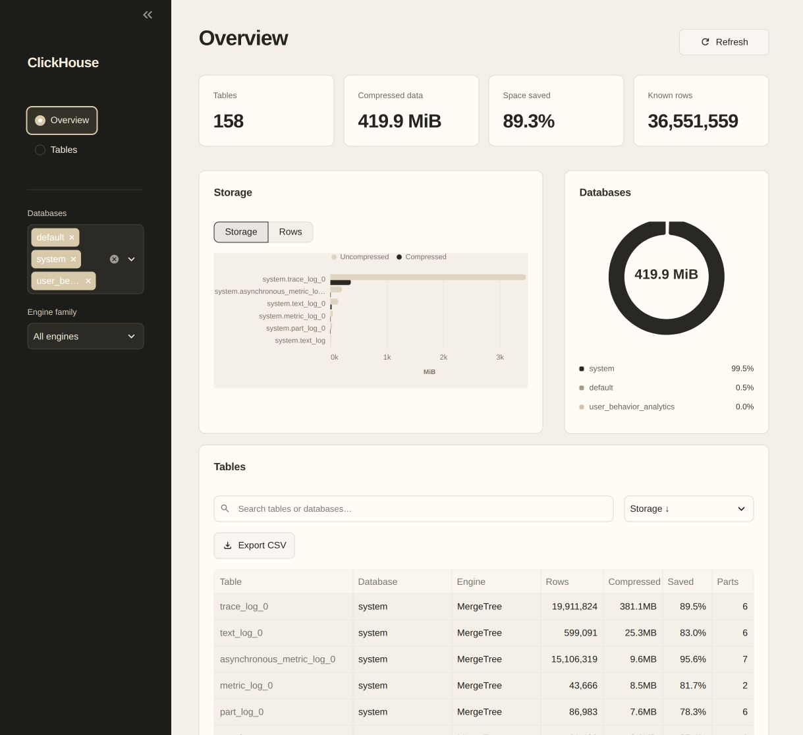
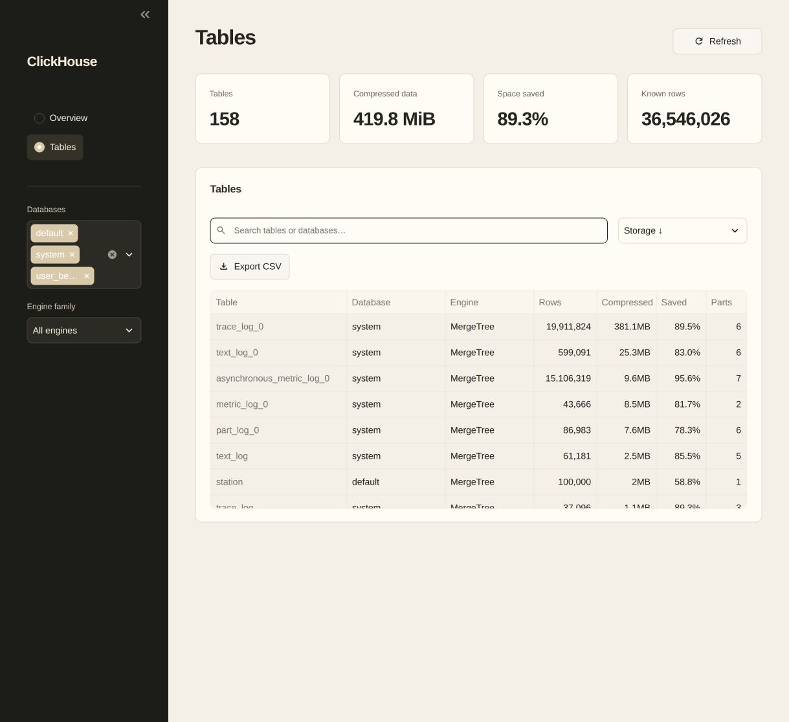

# ClickHouse dashboard

A Streamlit dashboard for the existing ClickHouse catalog. The interface reads `system.tables` and active `system.parts`; it requires no sample data and does not scan application event tables.

## Features

- Black and beige theme with consistent Arial typography.
- Overview with table count, compressed bytes, weighted physical compression, and known row counts.
- Storage and row-count charts, plus storage allocation by database.
- Table view with database and engine filters, literal search, sorting, and CSV export.
- System tables, application tables, views, and other engines remain visible in the catalog.
- Unknown metadata remains unavailable rather than being reported as zero.

Both pages use concise headings and control labels. Connection details, subtitles, decorative names, badges, supporting captions, and footer copy are omitted.

## Run locally

Verified with Python 3.12, Streamlit 1.66.1, Polars 2.0.0, Altair 6.3.0, ClickHouse Connect 1.11.0, and Docker ClickHouse 26.9.25.15.

```sh
uv venv --python 3.12
uv pip install -r requirements-dev.txt
cp .env.example .env
```

Configure the existing server credentials in `.env`. For local Docker HTTP:

```dotenv
CLICKHOUSE_BASE_URL=127.0.0.1
CLICKHOUSE_PORT=8123
CLICKHOUSE_SECURE=false
CLICKHOUSE_DATABASE=default
CLICKHOUSE_USER=your_existing_user
CLICKHOUSE_PASSWORD=your_existing_password
CLICKHOUSE_COMPRESSION_PROTOCOL=lz4
CLICKHOUSE_BATCH_SIZE=10000
```

`CLICKHOUSE_BASE_URL` is a hostname or IP without a scheme. Use the HTTP interface (`8123`) or your HTTPS port with `CLICKHOUSE_SECURE=true`, rather than native TCP port `9000`. Environment variables override `.env`. The database setting controls the client's initial database; the catalog view exposes all databases the account can see.

`CLICKHOUSE_DATABASE` defaults to `default`; `CLICKHOUSE_SECURE` defaults to `true`. The other settings remain required. `CLICKHOUSE_BATCH_SIZE` is retained for compatibility with the original configuration contract and is unused by this read-only dashboard.

Run from the repository root:

```sh
.venv/bin/python -m streamlit run clickhouse_admin_panel.py --server.address 127.0.0.1
```

Open [the dashboard](http://127.0.0.1:8501). Select databases and an engine family in the sidebar. Search and sorting apply to the table view and CSV export. Chart controls switch the footprint comparison between storage and known row counts. Refresh reloads the metadata snapshot; other widget interactions also read a fresh snapshot.

The runtime account needs SELECT access to `system.tables`, `system.columns`, and `system.parts`. The dashboard performs no data writes. Connection, query, and schema errors propagate; failures are not converted into successful empty results. Clients close after extraction.

## Metric contracts

| Metric | Source / calculation |
| --- | --- |
| Tables | Visible catalog relations in the selected databases and engine scope |
| Compressed data | Sum of compressed payload bytes in active parts |
| Space saved | `(1 - sum(compressed bytes) / sum(uncompressed bytes)) * 100` |
| Known rows | Sum of available `system.tables.total_rows` metadata |
| Parts | Number of active parts for that database and table |

Compression uses byte-weighted totals, not an average of table percentages. Database and table names form the join key, so same-named tables in different databases remain separate. Active parts are aggregated before combining them with the catalog, consistent with the ClickHouse `query-join-filter-before` guidance.

Physical sizes exclude inactive parts and auxiliary files such as indexes. They describe the connected server, not a cluster-wide total. Views and other non-MergeTree engines retain unavailable part-size and compression values. Empty MergeTree tables have zero physical bytes and unavailable compression. A scope containing only unknown values shows unavailable totals; an empty selection has zero tables. Negative compression is possible when encoding overhead exceeds the uncompressed data size.

Catalog row counts remain nullable. The dashboard does not issue COUNT queries to replace missing metadata. A zero denominator produces an unavailable compression percentage. No historical change or trend values are invented.

Catalog discovery excludes the duplicate compatibility databases `information_schema` and `INFORMATION_SCHEMA`, plus internal `.inner*` relations. It otherwise includes existing system and application relations, including `system.tables` itself.

The original `ClickHouseDataExtraction` and `transform` functions remain available for logical compression workflows. Their SQL is retained separately and regression-tested. That pipeline requires an integer `Event Count` column and scans those source tables when explicitly invoked; the current metadata dashboard does not calculate logical compression.

## Source layout

- `catalog.py`: metadata extraction, typed frames, filtering, and aggregate metric contracts.
- `dashboard.py`: the Overview and Tables views.
- `ui/dashboard.css` and `.streamlit/config.toml`: layout, typography, and theme.
- `clickhouse_admin_panel.py`: application entry point, client creation, and the original compression pipeline.
- `settings.py`: environment configuration, loaded when the app runs.
- `sql/catalog.sql`, `sql/storage_summary.sql`, `sql/server_version.sql`: dashboard queries.
- `sql/discover_tables.sql`, `sql/logical_compression.sql`, `sql/physical_compression.sql`: retained compression-pipeline queries.
- `tests/sql/`: fixture and verification SQL.

All executable SQL remains outside the Python source. Dynamic SQL values use driver parameters; logical-pipeline identifiers are quoted and escaped.

## Verification

```sh
.venv/bin/python -m pytest -q
.venv/bin/ruff check .
.venv/bin/ruff format --check .
```

Run all integration tests against the configured Docker server:

```sh
.venv/bin/python -m pytest --clickhouse -q
```

Integration tests create and remove two uniquely named temporary databases. The test account needs CREATE DATABASE/TABLE/VIEW, INSERT, OPTIMIZE, and DROP privileges in addition to SELECT. Those privileges are unnecessary for normal dashboard use.

Verified on 23 October 2026: **17 tests passed** against Docker ClickHouse **26.9.25.15**. Coverage includes real catalog rendering, database and engine scopes, search, page navigation, empty selections, nullable metadata, byte-weighted summaries, cross-database table names, and the retained compression pipeline's aggregation, identifier, read-only-request, and error-propagation contracts.

The app was also verified in the in-app browser against the existing server catalog, including its system tables.





## Docker server

The separate `../clickhouse-docker/docker-compose.yml` project is pinned to `clickhouse/clickhouse-server:26.9.25.15`. It was previously upgraded from 26.1.2.11 after confirming the requested 26.10 image was not published. All six existing application tables and row counts were preserved. That upgrade retained persistent mounts and saved a recovery copy under `/tmp/streamlit-admin-clickhouse-upgrade/`.

The dashboard uses the existing Docker server. No host ClickHouse server is required or started.
